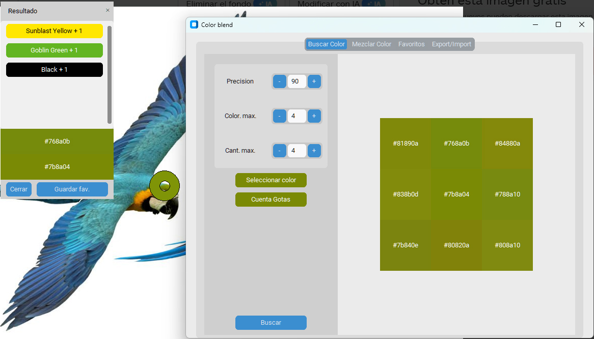
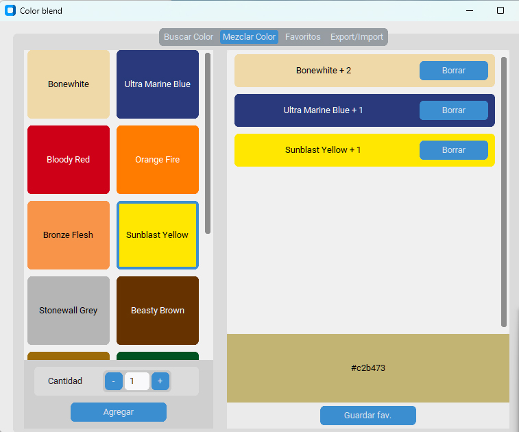
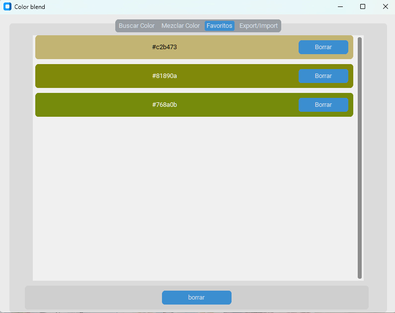
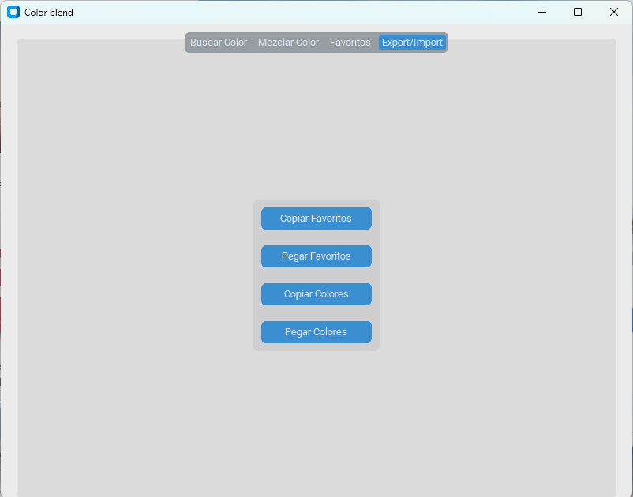

# app-color-blend

Find the recipe for mixing a color from a paint set (Vallejo Game Color).

Busca la receta de la mezcla de un color desde un conjunto de pinturas (Vallejo Game Color).









## Funciones / Features

- **Buscar color**: elige un color (selector o cuentagotas de pantalla) y la app prueba todas las
  mezclas posibles de la paleta para mostrar las 8 más parecidas.
  *Pick a color (chooser or screen eyedropper) and get the 8 closest mixes from the palette.*
- **Mezclar color**: añade gotas de cada pintura y mira el resultado al momento.
  *Add drops of each paint and see the result.*
- **Favoritos**: guarda las recetas que te interesen. Se guardan solas en disco.
  *Save recipes; they are stored automatically.*
- **Export/Import**: copia o pega la paleta y los favoritos como JSON (portapapeles o archivo).
  *Copy/paste palette and favorites as JSON (clipboard or file).*

### Modo de mezcla / Mix mode

- **Pigmento** (por defecto): simula la mezcla de pintura. Cada pintura absorbe parte de la luz
  que deja pasar la otra (media geométrica de la reflectancia de cada canal), así que azul +
  amarillo da verde y rojo + blanco da rosa. Es una aproximación: con solo 3 canales no se puede
  reproducir el espectro real de un pigmento.
  *Subtractive paint-like mixing (weighted geometric mean of per-channel reflectance).*
- **Luz (RGB)**: media de los valores RGB, como al mezclar luces.
  *Plain RGB average, like mixing light.*

### ΔE

El parecido entre colores se mide con **CIEDE2000 (ΔE)**, que tiene en cuenta cómo percibe el ojo
las diferencias. Orientativo: < 1 imperceptible, 1–2 solo se nota de cerca, 2–10 se nota a simple
vista. *Color difference uses CIEDE2000.*

### Datos guardados / Saved data

La paleta, los favoritos y el modo de mezcla se guardan en:

- Windows: `%APPDATA%\ColorBlend\data.json`
- Linux / macOS / Android: `~/.color_blend/data.json`

Si el archivo se estropea, se renombra a `data.json.bak` y la app arranca con la paleta por defecto.

## Uso / Usage

Requiere Python 3.9 o superior con `tkinter`.

```sh
pip install -r requirements.txt
python main.py
```

### Tests

```sh
pip install -r requirements-dev.txt
pytest
```

### Crear el ejecutable / Build the executable

```sh
pyinstaller --onefile --noconsole --name color-blend main.py
```

El ejecutable queda en `dist/`. Para distribuirlo, súbelo a una *Release* de GitHub en lugar de
añadirlo al repositorio.

## Estructura / Layout

| Archivo | Contenido |
|---|---|
| `main.py` | punto de entrada |
| `color_blend/color.py` | `Color`, conversión a Lab y ΔE (CIEDE2000) |
| `color_blend/mixing.py` | modos de mezcla (pigmento y RGB) |
| `color_blend/model.py` | modelo: paleta, favoritos, búsqueda de mezclas, JSON |
| `color_blend/storage.py` | guardado en disco |
| `color_blend/palettes.py` | paleta Vallejo Game Color |
| `color_blend/widgets.py` | widgets de customtkinter |
| `color_blend/views.py` | pestañas de la app |
| `color_blend/app.py` | ventana principal |
| `tests/` | tests de la lógica (pytest) |
